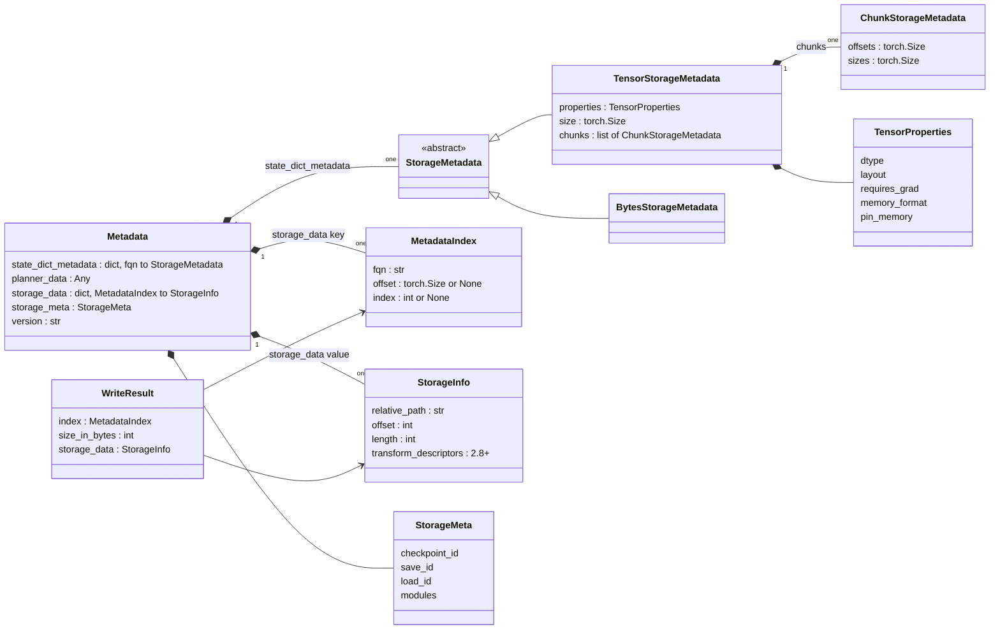
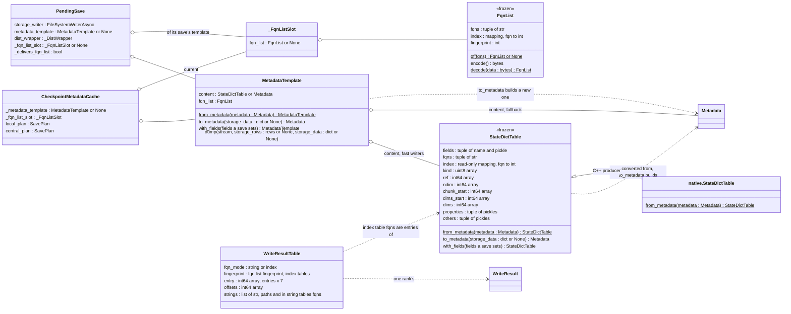
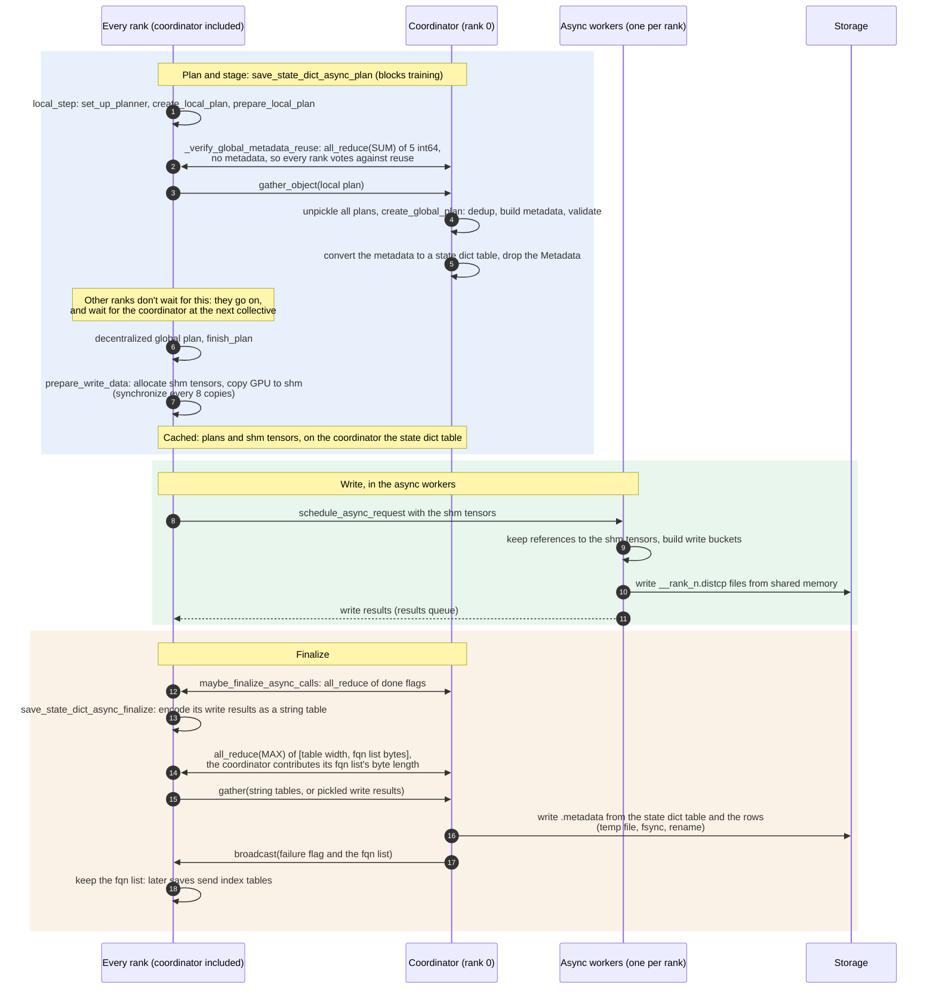
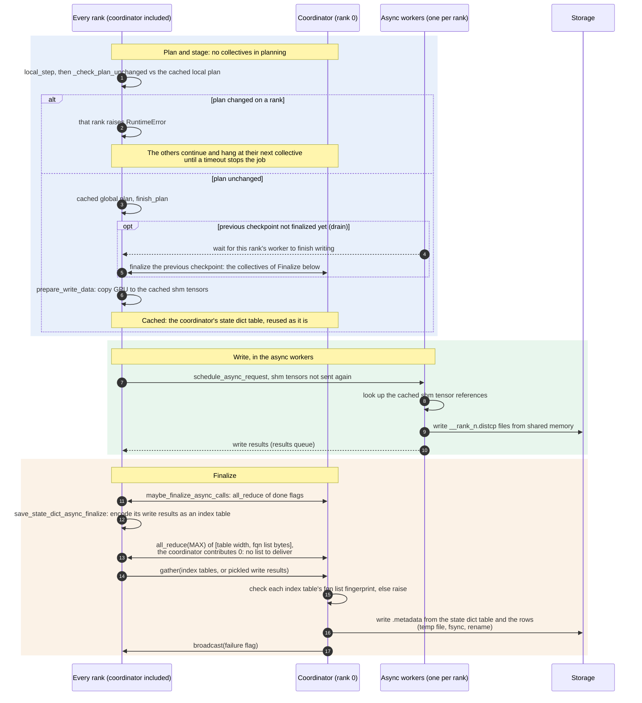
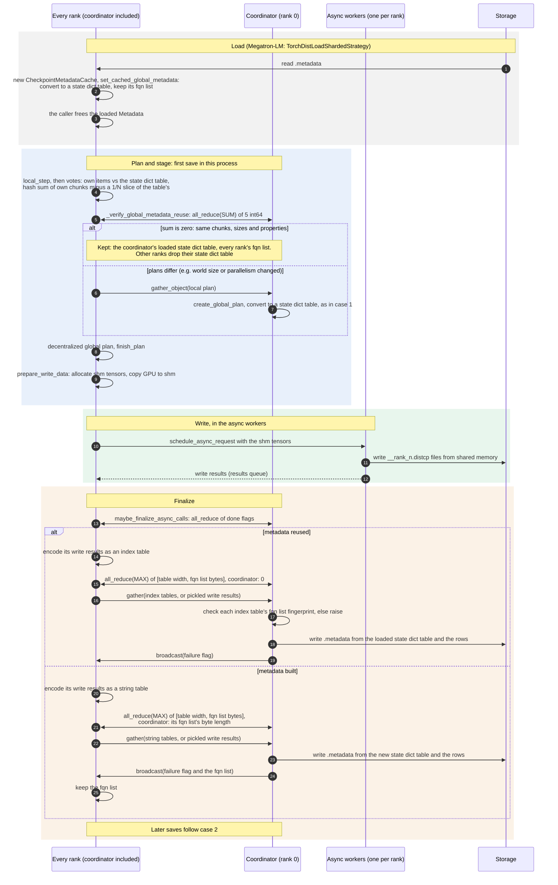

# Async Checkpoint Save: Planning, Staging, Global Metadata Reuse and Tables

This document describes how a torch DCP checkpoint is saved through NVRx on the decentralized planning path with CPU shared-memory staging; how the global metadata and staging buffers are reused between saves; and how the global metadata is kept between saves, sent to the coordinator and written. It also describes the changes made within NVRx to optimize data structures using `numpy` tables instead of Python objects for locality, to minimize bytes sent over the wire, and to reduce pickling and unpickling overheads.

Scope:

- The planner and the storage writer both set `can_run_decentralized_global_plan` (Megatron-LM's `MCoreSavePlanner` with `FileSystemWriterAsync`).
- `enable_cache=True` and `use_cached_data_structure=True` (Megatron-LM: `--ckpt-assume-constant-structure`).
- CPU shared-memory staging: `FileSystemWriterAsync(use_cpu_shm_for_gpu_tensors=True)` and a persistent `AsyncCallsQueue(cpu_shm_mode=True)` (Megatron-LM: `--async-ckpt-use-cpu-shm`).
- A torch version the fast `.metadata` writers were tested with. Other paths are listed under [Paths](#paths).

A DCP `Metadata` holds a Python object per chunk, each with a `torch.Size` of offsets and of sizes, and its `storage_data` one more per chunk. If kept between saves, they will slow down every full garbage collection, most of all on the coordinator, whose built metadata lies scattered across the heap. Another source of overhead is when the coordinator rank must unpickle every rank's write result, slowing down the coordinator and holding up all ranks when finishing the checkpoint write. Tables reduce the wire traffic and the unpickling overhead.

## Terms

| Term               | Meaning                                                                                                                                                                                                                    |
| ------------------ | -------------------------------------------------------------------------------------------------------------------------------------------------------------------------------------------------------------------------- |
| Local plan         | A rank's `SavePlan` from `planner.create_local_plan()`: one `WriteItem` per tensor chunk or bytes entry the rank writes.                                                                                                   |
| Global plan        | A rank's local plan after `create_decentralized_global_plan` and `prepare_decentralized_global_plan`; the writer adds the file prefix `__<rank>_`. Each rank makes its own; on this path the coordinator does not.         |
| Global metadata    | The `Metadata` written to `.metadata`. `state_dict_metadata` is built from the write items of all ranks' local plans; `storage_data` (file, offset, length of each chunk) is built from the write results at finalization. |
| Coordinator        | The planning rank that builds the global metadata and writes `.metadata` (rank 0 in Megatron-LM).                                                                                                                          |
| Shm tensor         | A CPU tensor in shared memory (`share_memory_()`), one per tensor the rank saves, holding the values being written.                                                                                                        |
| Async worker       | The persistent process per rank that writes the files. In CPU shared-memory mode it never initializes CUDA.                                                                                                                |
| Fast writers       | nvrx's `.metadata` writers (C++, else Python), used on tested torch versions (`_metadata_pickler/writer.py`).                                                                                                              |
| State dict table        | A `Metadata` without `storage_data` as arrays (`StateDictTable`), kept between saves.                                                                                                                                      |
| Metadata template  | A save's global metadata without the parts each save sets (`storage_data`, `version`, `storage_meta`): a `MetadataTemplate`, kept between saves and completed by each write.                                     |
| Write-result table | One rank's write results as a table, gathered to the coordinator. A string table names fqns by string, an index table by their entry in the fqn list.                                                                      |
| fqn list           | The fqns of the coordinator's state dict table, in entry order.                                                                                                                                                                 |

## Phases of a save

1. **Plan and stage**, in the training process, blocking training: `save_state_dict_async_plan` in `state_dict_saver.py` plans the save and returns a `PendingSave` object, then `FileSystemWriterAsync.prepare_write_data` copies every tensor into its shm tensor.
2. **Write**, in the async worker: the shm tensors are written to `__<rank>_<n>.distcp` files; no device-to-host copy is left to do.
3. **Finalize**, in the training process, blocking training: `save_state_dict_async_finalize(pending_save)` gathers the write results on the coordinator as write-result tables, and the coordinator writes `.metadata`. It runs from `AsyncCallsQueue.maybe_finalize_async_calls` once all ranks' workers are done, or at the latest at the next save, before its staging overwrites the shm tensors.

## DCP metadata

The `.metadata` file is a pickled `Metadata` (`torch.distributed.checkpoint.metadata`; `_StorageInfo` is in `filesystem.py`, `WriteResult` in `storage.py`). The edge labels say how many objects a checkpoint has: one per fqn, or one per chunk, a chunk being one rank's slice of a tensor.

**Note:** `StorageMetadata` is not a torch class: torch types `state_dict_metadata`'s values as the union `STORAGE_TYPES = TensorStorageMetadata | BytesStorageMetadata`. `StorageInfo` is torch's `_StorageInfo`. A `MetadataIndex` names a chunk by fqn and offset (equal to the chunk's `offsets`); a bytes entry has no offset. Each rank's write results are its `storage_data` items, from which the coordinator builds `storage_data`.

## NVRx types

`FqnList`: the fqns of the coordinator's state dict table in entry order, replicated on every rank through `_FqnListSlot` (see the protocol below). Metadata with an fqn that isn't a `str` has no fqn list: `FqnList.of` returns `None`, the slots stay empty, and every rank sends string tables. A `StateDictTable` is checked when it is created and is immutable: its sequences are tuples, its index read-only and its arrays read-only. `native.StateDictTable` only replaces `from_metadata` with the C++ producer, which builds the same table, so each writer module exports a `StateDictTable` with the same interface. `writer.state_dict_table_if_fast` converts with the selected module's, or returns `None` when the fast writers aren't used.

A `MetadataTemplate`'s `content` is either a state dict table or a `Metadata`. It is a state dict table whenever the fast writers are used. It falls back to a `Metadata` (without `storage_data`, sharing the caller's `state_dict_metadata`) when the fast writers are turned off with `NVRX_FAST_METADATA_PICKLE=0`, when the torch version is untested or fails the layout check, or when the table can't represent the metadata (a subclass of `Metadata`, a `state_dict_metadata` that isn't a `dict`, or an fqn that isn't a `str`). `to_metadata` builds a new `Metadata` each time it is called. torch's `finish` and the `global_metadata` property use it, and nothing keeps the result. Its `storage_data` argument is the dict `Metadata.storage_data` holds, `MetadataIndex` to `_StorageInfo`, not write results: `finish` builds that dict from the write results, and `dump` writes it from the gathered rows on the fast path. `with_fields` sets fields a save sets (`version`, `storage_meta`), and raises `TypeError` for any other name. `WriteResultTable` is a decoded write-result table, numpy views into the gathered rows. Its `strings` are the relative paths, a few per rank, and in a string table also the fqns; an index table names fqns by their entry in the fqn list. `fqn_mode` says whether the `fqn` column holds strings or indices. In an index table, `fingerprint` identifies the fqn list the table was encoded against. The coordinator checks it against its own list and raises if they differ. It is only a safety check.

## Table schemas

### State dict table

Entries are in `state_dict_metadata`'s order; entry `i` is one fqn, of one of three kinds:

- BYTES: a `BytesStorageMetadata` without attributes;
- TENSOR: a `TensorStorageMetadata` with exactly `properties`, `size` and `chunks`, whose chunks are `ChunkStorageMetadata` with exactly `offsets` and `sizes`, each a `torch.Size` of the tensor's number of dims;
- OTHER: anything else (a subclass, a tuple instead of a list, an extra attribute), kept as its pickle in `others`.

Per entry (`n` entries, `+ 1` for the start columns, whose last value is the end):

| Column        | Type  | Value                                                            |
| ------------- | ----- | ---------------------------------------------------------------- |
| `kind`        | uint8 | BYTES, TENSOR or OTHER.                                          |
| `ref`         | int64 | TENSOR: index into `properties`. OTHER: index into `others`.     |
| `ndim`        | int64 | The tensor's number of dims; 0 for BYTES and OTHER.              |
| `chunk_start` | int64 | Number of the entry's first chunk, counting all entries' chunks. |
| `dims_start`  | int64 | Start of the entry's values in `dims`.                           |

`dims` (int64) holds each tensor entry's values in one range: its `size`, then each chunk's `offsets` and `sizes`. Entry `i`'s `size` is `dims[dims_start[i] : dims_start[i] + ndim[i]]`, and chunk `k` starts at `dims_start[i] + ndim[i] + 2 * ndim[i] * k`, so the range holds `ndim * (1 + 2 * chunks)` values. BYTES and OTHER entries have none. `chunk_start` is kept rather than derived because a 0-dim tensor has no values whatever its number of chunks.

### Write-result table

One rank's write results, little-endian, gathered to the coordinator zero-padded to a common width.

| Section      | Type                 | Value                                                                                          |
| ------------ | -------------------- | ---------------------------------------------------------------------------------------------- |
| `header`     | int64[8]             | Magic, version, entries, strings, string bytes, offset values, fqn mode, fqn list fingerprint. |
| `string_len` | int64[strings]       | Each string's length in bytes.                                                                 |
| `entry`      | int64[entries, 7]    | One write result per row, columns below.                                                       |
| `offsets`    | int64[offset values] | The `MetadataIndex` offsets, concatenated in entry order.                                      |
| `strings`    | bytes                | The strings, UTF-8, concatenated: relative paths, and in a string table the fqns.              |

| Column        | Value                                                                                                         |
| ------------- | ------------------------------------------------------------------------------------------------------------- |
| `fqn`         | `MetadataIndex.fqn`: a string id in a string table, an entry of the coordinator's fqn list in an index table. |
| `index`       | `MetadataIndex.index`, if set.                                                                                |
| `offset_ndim` | The number of dims of `MetadataIndex.offset`: how many `offsets` values are this entry's.                     |
| `path`        | `_StorageInfo.relative_path`: a string id.                                                                    |
| `offset`      | `_StorageInfo.offset`.                                                                                        |
| `length`      | `_StorageInfo.length`.                                                                                        |
| `flags`       | Whether `index` is set, whether the `MetadataIndex` has an offset, and whether that offset is a `torch.Size`. |

## State kept between saves

`CheckpointMetadataCache`, one per training process, kept by the caller across saves (Megatron-LM: in the save strategy):

| State                                     | Rank        | When                                                                    |
| ----------------------------------------- | ----------- | ----------------------------------------------------------------------- |
| `MetadataTemplate` of the loaded checkpoint | all ranks   | From `set_cached_global_metadata` until the first save.                 |
| `MetadataTemplate` of the previous save     | coordinator | After a save, built or reused.                                          |
| fqn list slot (`_FqnListSlot`)             | all ranks   | A new one from `set_cached_global_metadata` and from each build.        |
| `local_plan`, `central_plan`              | all ranks   | This rank's local and global plan of the previous save.                 |

Each `MetadataTemplate` has its fqn list slot. It holds the template's fqn list on the coordinator, and on the other ranks once they have the list: from `set_cached_global_metadata`, or delivered by the finalize of the save that built the template. Saves that reuse the template share its slot, and each `PendingSave` refers to the slot of the template its save writes. A finalize delivers into its own save's slot, so a save that is finalized after the next one was planned never changes the list the next one encodes against.

A `MetadataTemplate` is never modified: `finish` writes it with the save's `storage_data`, `version` and `storage_meta`, which are not kept. The caller can free the `Metadata` it hands to `set_cached_global_metadata`: as a state dict table, the cache keeps none of its objects.

Staging buffers, keyed by a hash of the rank's tensor write items:

| Cache                                       | Process  | Content                                                                       |
| ------------------------------------------- | -------- | ----------------------------------------------------------------------------- |
| `FileSystemWriterAsync._shm_tensor_cache`   | training | The shm tensors, reused by later saves with the same items.                   |
| `FileSystemWriterAsync._cached_identifiers` | training | Keys whose shm tensors the worker already holds.                              |
| `PersistentAsyncCaller._worker_data_cache`  | worker   | References to the same shm tensors, so they are sent to the worker only once. |

Both are empty in a new process. `FileSystemWriterAsync.cleanup_tensor_caches` clears the training-side caches when the worker restarts.

## 1. First checkpoint of a job

No checkpoint was loaded, so there is no metadata to reuse. Every rank still takes part in the reuse vote, which keeps the collectives the same on all ranks. The coordinator builds the metadata, which only it has, so the ranks send string tables, and the finalize delivers the fqn list. The shm tensors are allocated and sent to the worker.

## 2. Later checkpoints in the same job

`enable_cache` promises that the checkpoint structure doesn't change between saves, so the previous save's plans and metadata are reused without any communication during planning. Each rank still creates its local plan and compares it with the previous one, so a broken promise raises an error instead of writing a checkpoint whose `.metadata` doesn't match its data.

Staging copies the new values into the same shm tensors. If the previous checkpoint hasn't been finalized yet, its worker may still be reading them, so it is finalized first (`maybe_finalize_async_calls(blocking=True, no_dist=True)`, registered by `AsyncCallsQueue`). All ranks reach this point in the same save, so the finalization's collectives match. Every rank holds the coordinator's fqn list, so the ranks send index tables.

## 3. First checkpoint after a restart

Every rank reads `.metadata` when loading the checkpoint, and the caller passes it to `set_cached_global_metadata` on every rank, which converts it to a state dict table and keeps its fqn list; the caller can then free it. The first save checks whether the new local plans write exactly the chunks this metadata lists. That decides with one `all_reduce` whether the gather and `create_global_plan` can be skipped; nothing beyond the ordinary `.metadata` is stored for it. The staging caches are empty in the new processes, so the shm tensors are allocated and sent as in case 1.

### Why the reuse check is sufficient

- On this path the global metadata's `state_dict_metadata` is a function of the write items alone (`create_default_global_save_plan` concatenates them). Each item maps to a metadata entry with its fqn, type, global size, properties and chunk (offsets, sizes).
- Each rank checks that its tensor items' entries have the same global size and properties, compared with `==`.
- A 128-bit hash of each chunk covers its fqn, bytes or tensor, offsets and sizes. Each rank adds up the hashes of its own items and subtracts those of its 1/N slice of the metadata's chunks. The sum over all ranks is zero if, and (up to 2^-127) only if, the chunks written now are those the metadata lists, each exactly once. Missing, extra and duplicated chunks all leave a non-zero sum.
- Which rank writes a chunk doesn't matter: the metadata doesn't record it, and `storage_data` is rebuilt from this save's write results. Chunks may move between ranks.
- Plan validation (torch's `_validate_global_plan`, Megatron-LM's `validate_global_plan`) depends only on `state_dict_metadata`, which equals that of a checkpoint that passed validation when it was written.
- Reuse is refused if the plans or the metadata carry planner data, which isn't checked, or if torch's `ChunkStorageMetadata` has fields other than `offsets` and `sizes`.

## Paths

F: fast writers usable. D: decentralized planning (`can_run_decentralized_global_plan` of planner and storage writer). C: `enable_cache`.

| F   | D   | C   | Kept between saves    | Reuse of a loaded checkpoint | Write results       | fqns in write results                  | `.metadata` written from |
| --- | --- | --- | --------------------- | ---------------------------- | ------------------- | -------------------------------------- | ------------------------ |
| yes | yes | yes | state dict table, fqn list | checked with one all_reduce  | write-result tables | indices, strings in a save that builds | state dict table and rows     |
| yes | no  | yes | state dict table, fqn list | no, cached from the 2nd save | write-result tables | indices, strings in a save that builds | state dict table and rows     |
| yes | any | no  | nothing               | no                           | write-result tables | strings                                | `Metadata` and rows      |
| no  | any | any | `Metadata`, as before | as before                    | pickled             | strings                                | torch's `finish`         |

The first row is the fast path (Megatron-LM). On every path:

- A rank whose write results don't fit a table sends them pickled; the coordinator handles each rank's payload as it is.
- A storage writer that overrides `finish` gets a `Metadata` and `WriteResult`s, and its ranks send string tables.
- A save that builds metadata delivers the fqn list only if its storage writer writes from tables, which every rank decides alike. Otherwise nothing could read index tables, so the list isn't sent.
- If the C++ writer fails, the Python writer writes `.metadata`; if that fails, `pickle.dump` writes the `Metadata` built from the table.

Without `enable_cache`, nothing is kept: planning builds a `Metadata` every save, the ranks send string tables, and the coordinator writes the `Metadata` with the fast writer.

## Invariants

1. **The fqn list a rank encodes against is the coordinator's.** It holds by construction, not by agreement at run time:
   - after a reuse, every rank holds the loaded checkpoint's state dict table, which is the coordinator's metadata;
   - after a build, the save's finalize delivers the coordinator's list to every rank, into the slot of the template it built, even if the save failed (only when the storage writer writes from tables; otherwise every rank sends strings);
   - a save's finalize runs before the next save's finalize encodes anything: the next save finalizes the previous one before staging overwrites its shared memory (case 2);
   - with `enable_cache`, the coordinator rank and the checkpoint structure stay the same between saves; a rank that breaks this raises (`_update`, `_check_plan_unchanged`);
   - `set_cached_global_metadata` is called on every rank with the same loaded checkpoint.
2. **A broken invariant fails the save, it never writes a wrong `.metadata`.** An index table carries the fingerprint of the list it was encoded against; the coordinator raises on a mismatch, which every rank receives as a `CheckpointException` through the failure broadcast.
3. **The collectives are the same on every rank.** A rank chooses between strings and indices in finalize, when it encodes, not when the save is planned. It sends indices if its save's fqn list slot holds the list, else strings. The coordinator can mix both kinds of table in one save, so the ranks don't need to agree. Saves are finalized in order on every rank, a save that built the metadata delivers its list at the end of its finalize, and the finalize of a save runs on all ranks or none (the done-flags all_reduce, or the drain, which every rank reaches in the same save). So a save planned before the previous one was finalized (case 2, drain) gets the list in time if it reuses the previous save's metadata. If a checkpoint was loaded in between, it encodes against the loaded list. The list travels in collectives that run every save. A failure on the coordinator after the gather, reading the gathered results or writing `.metadata`, is raised on every rank through the same broadcast. In the reuse vote, a rank that can't read the loaded metadata votes against reuse instead of raising.
4. **Nothing is modified in place.** `MetadataTemplate` and state dict tables are never changed; a save's `storage_data`, `version` and `storage_meta` are added when writing. The `Metadata` passed to `set_cached_global_metadata` is not modified.

## Other transfer path

Without CPU shared memory (`use_cpu_shm_for_gpu_tensors=False`, the `FileSystemWriterAsync` default), `prepare_write_data` hands the GPU tensors to the worker through CUDA IPC, and the worker copies them to host memory in `preload_tensors`. Planning and metadata reuse are the same.

## Code map

| What                                          | Where (`src/nvidia_resiliency_ext/checkpointing/async_ckpt/`)                                                                                            |
| --------------------------------------------- | -------------------------------------------------------------------------------------------------------------------------------------------------------- |
| Planning, cache, reuse decision               | `state_dict_saver.py`: `save_state_dict_async_plan`, `PendingSave`, `CheckpointMetadataCache`, `_verify_global_metadata_reuse`, `_check_plan_unchanged` |
| Reuse check against loaded metadata           | `_metadata_reuse.py`, reading a state dict table through `TableEntries`                                                                                       |
| Finalization                                  | `state_dict_saver.py`: `save_state_dict_async_finalize`                                                                                                  |
| Staging into shared memory, `.metadata`       | `filesystem_async.py`: `FileSystemWriterAsync` (`prepare_write_data`, `finish`, `_finish`)                                                               |
| Writing in the worker                         | `filesystem_async.py`: `preload_tensors`, `write_preloaded_data_*`                                                                                       |
| Cached metadata template                      | `_metadata_template.py`: `MetadataTemplate`                                                                                                                 |
| Pickle opcodes of small objects               | `_metadata_pickler/opcodes.py`                                                                                                                           |
| State dict table and its Python producer           | `_metadata_pickler/state_dict_table.py`                                                                                                                       |
| Write-result tables                           | `_metadata_pickler/table.py`                                                                                                                             |
| `.metadata` writers                           | `_metadata_pickler/`: `writer.py` (selection), `native.py` and `native_src/native.cpp` (C++), `pickler.py` (Python)                                      |
| Async workers, finalize scheduling, shm drain | `core.py`: `AsyncCallsQueue`, `PersistentAsyncCaller`                                                                                                    |
