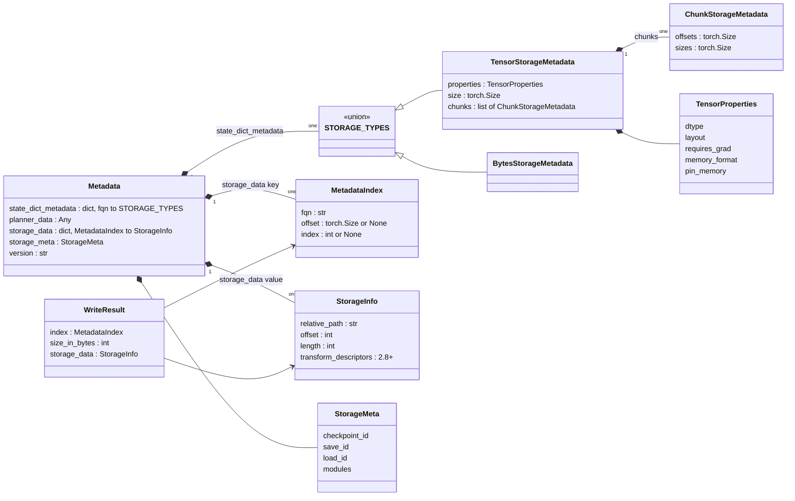
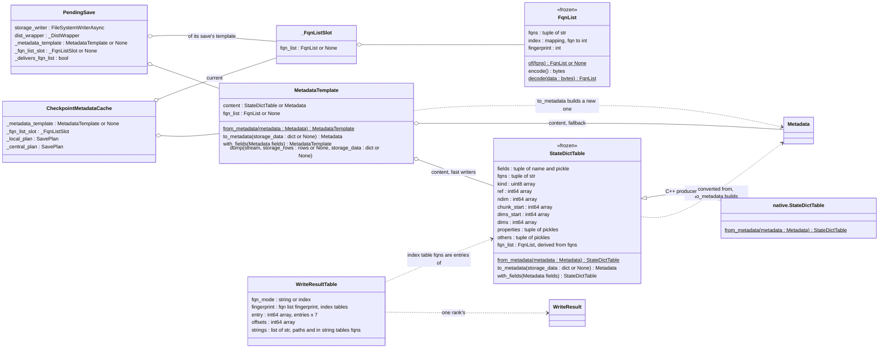
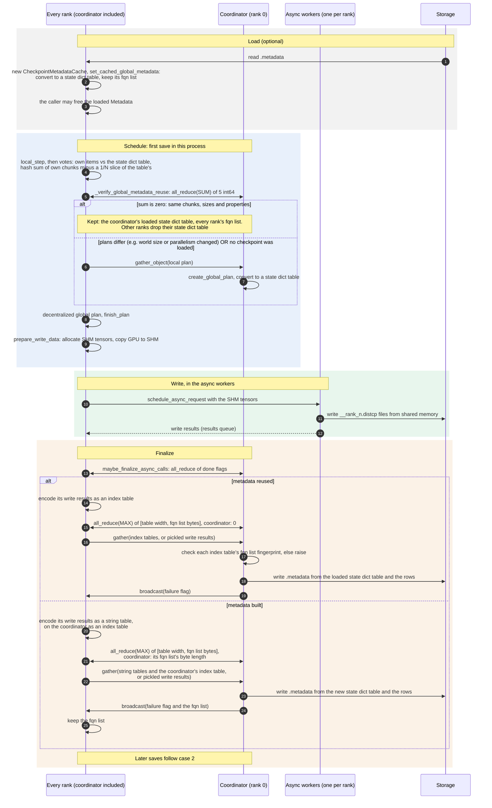

# Async Checkpoint Save: Planning, Staging, Global Metadata Reuse and Tables

This document describes how NVRx saves a checkpoint on the decentralized path with CPU shared-memory staging. It explains how the global metadata and staging buffers are reused between saves. It also describes data structure optimizations to store metadata between saves and when collecting write results from all the ranks involved in the distributed checkpoint to achieve high cache locality, reduce wire traffic, and enable faster writes.

## Scope

- The planner and the storage writer both set `can_run_decentralized_global_plan` (`FileSystemWriterAsync` does).
- `enable_cache=True` and `use_cached_data_structure=True`.
- CPU shared-memory staging: `FileSystemWriterAsync(use_cpu_shm_for_gpu_tensors=True)` and a persistent `AsyncCallsQueue(cpu_shm_mode=True)`.
- The `PendingSave` that `save_state_dict_async_plan` returns is passed to `save_state_dict_async_finalize` as it is.
- A torch version the fast `.metadata` writers were tested with. Other paths are listed under [Paths](#paths).

## Terms

| Term               | Meaning                                                                                                                                                                                                                                                                                                        |
| ------------------ | -------------------------------------------------------------------------------------------------------------------------------------------------------------------------------------------------------------------------------------------------------------------------------------------------------------- |
| Local plan         | A rank's `SavePlan` from `planner.create_local_plan()`: one `WriteItem` per tensor chunk or bytes entry the rank writes.                                                                                                                                                                                       |
| Global plan        | A rank's local plan after `create_decentralized_global_plan` and `prepare_decentralized_global_plan`; the writer adds the file prefix `__<rank>_`. Each rank makes its own global plan on this path.                                                                                                           |
| Global metadata    | The `Metadata` written to `.metadata`. Has two components – `state_dict_metadata` is built from the write items of all ranks' local plans when save is scheduled (or is reused from a loaded checkpoint), `storage_data` (file, offset, length of each chunk) is built from the write results at finalization. |
| Coordinator        | The planning rank that builds the global metadata and writes `.metadata` (rank 0 by default).                                                                                                                                                                                                                  |
| SHM tensor         | A CPU tensor in shared memory (`share_memory_()`), one per tensor the rank saves, holding the values being written.                                                                                                                                                                                            |
| Async worker       | The persistent process per rank that writes the files. In CPU shared-memory mode it never initializes CUDA.                                                                                                                                                                                                    |
| Fast writers       | nvrx's `.metadata` writers (C++, else Python), used on tested torch versions (`_metadata_pickler/writer.py`).                                                                                                                                                                                                  |
| State dict table   | A `Metadata` without `storage_data`, storing `state_dict_metadata` as arrays (`StateDictTable`), kept between saves.                                                                                                                                                                                           |
| Metadata template  | A save's global metadata without the parts each save sets (`storage_data`, `version`, `storage_meta`): a `MetadataTemplate`, kept between saves and completed by each write. Holds either `Metadata` or `StateDictTable`.                                                                                      |
| Write-result table | One rank's write results as a table, gathered to the coordinator. A string table names fqns by string, an index table by their entry in the fqn list.                                                                                                                                                          |
| fqn list           | The fqns of the coordinator's state dict table, in entry order, shared by all ranks, either from the loaded checkpoint or from the coordinator.                                                                                                                                                                |

## Phases of a save

1. **Schedule:** In the training process, `save_state_dict_async_plan` plans the save, has `FileSystemWriterAsync.prepare_write_data` copy every tensor to SHM (CPU SHM mode only), and returns a `PendingSave` object.
2. **Write:** In the worker process, every asynchronous worker writes to disk tensors copied into CPU SHM during the Schedule phase, and BytesIO objects. (In the non SHM mode, device-to-host copies also happen here, but that is not part of this document.)
3. **Finalize:** In the training process, after all ranks have finished writing their data to disk, collect their write results (file relative paths and offsets into the file for each tensor or BytesIO object written), and write the `.metadata` file as a pickled representation of `Metadata`. Other finalize functions may be registered by the user, e.g., to delete older checkpoints.

## Torch DCP Metadata

The `.metadata` file is a pickled `Metadata` (`torch.distributed.checkpoint.metadata`; `_StorageInfo` is in `filesystem.py`, `WriteResult` in `storage.py`). The edge labels say how many objects a checkpoint has: one per fqn, or one per chunk, a chunk being one rank's slice of a tensor.

**Note:** PyTorch defines a union `STORAGE_TYPES = TensorStorageMetadata | BytesStorageMetadata`. `StorageInfo` is torch's `_StorageInfo`. A `MetadataIndex` names a chunk by fqn and offset (equal to the chunk's `offsets`); a bytes entry has no offset. The coordinator builds `storage_data` from all ranks' list of `WriteResult`.

## NVRx types

PyTorch's types have some fundamental performance issues:

- FQNs are repeated many times. The same FQNs repeat in `state_dict_metadata` and in `storage_data`, and are transmitted by all ranks. Each string is pickled individually without any deduplication or compression, resulting in large file sizes when writing, and in large wire traffic as the coordinator gathers results.
- `StorageInfo.relative_path` is also repeated within a rank. Every relative path is of the format `__<rank>_<n>.distcp`. Usually, only one file is written per rank, but the relative path is repeated in every `StorageInfo`.
- Every entry in `state_dict_metadata` or `storage_data` is a Python object which contains other Python objects. This grows very quickly into a large tree with millions of objects. For example, with 100 tensor chunks per rank and 10,000 ranks, we end up with 1,000,000 tensor chunk objects in `state_dict_metadata` and `storage_data`, each object holds multiple fields, so it's easy to end up with tens of millions of Python objects in the tree. Traversing this requires pointer chasing, which negatively affects cache locality, increases TLB misses, and drops IPC. Worse, the GC must also traverse every object, slowing the GC down as well.

To address these issues, NVRx uses a compact storage representation by defining its own types. Strings like FQNs are memoized into a list and referenced via an index. Tensor shapes and offsets are encoded as a pair of numpy arrays, one that holds the shapes and offsets contiguously, the other holds the starting location for each tensor's shape and offset. Tensor properties are pickled and deduplicated, multiple tensors may reference the same pickled representation of their properties. Similar optimizations are performed for `WriteResult` gathered during the `finalize` step. Further, as each rank writes FQNs that should already be present on the coordinator in its `state_dict_metadata`, ranks can reference the same list and only provide indices into this list during the `finalize` step.

Refer to the [paths](#paths) section below for when these optimizations are enabled. NVRx types are enabled only for tested PyTorch versions and may be overridden by the `NVRX_FAST_METADATA_PICKLE` environment variable. Setting it to `0` turns off these optimizations, setting it to `force` enables optimizations even for untested versions of PyTorch. This feature is never turned on for known-bad versions of PyTorch.

## Schemas

### StateDictTable

In the `StateDictTable`, `fields` is a tuple of `(name, pickled_representation)` pairs of fields in the original `Metadata` object. Only `state_dict_metadata` and `storage_data` have `None` for the pickled object fields. Then, every entry at position `i` corresponds to the same position in the original `Metadata.state_dict_metadata` object.

| Column        | Type       | Value                                                            |
| ------------- | ---------- | ---------------------------------------------------------------- |
| `fqns`        | tuple(str) | Fully qualified names of objects                                 |
| `kind`        | uint8      | BYTES, TENSOR or OTHER.                                          |
| `ref`         | int64      | TENSOR: index into `properties`. OTHER: index into `others`.     |
| `ndim`        | int64      | The tensor's number of dims; 0 for BYTES and OTHER.              |
| `chunk_start` | int64      | Number of the entry's first chunk, counting all entries' chunks. |
| `dims_start`  | int64      | Start of the entry's values in `dims`.                           |

`kind` could be one of `BYTES`, `TENSOR`, or `OTHER`. `BYTES` and `TENSOR` are used if the objects encoded are a `BytesStorageMetadata` or a `TensorStorageMetadata` encodable by this representation, anything else is `OTHER` and stored pickled. `chunk_start` is a running sum of the chunk count (i.e., if tensor `i` has `N` chunks, `chunk_start[i+1] - chunk_start[i] == N`). `dims_start` indexes into `dims` holding the dimensions of that tensor in the slice `dims[dims_start[i] : dims_start[i] + ndim[i]]`. Tensor chunk offsets and sizes are placed after the dims, so chunk `k` starts at `dims_start[i] + ndim[i] + 2 * ndim[i] * k`. Zero dim tensors (scalars) cannot have more than one chunk if stored as `TENSOR` – they are stored as `OTHER` if more than one chunk exists.

### WriteResultTable

Holds one rank's write results, little endian, collected on the coordinator rank.

| Section      | Type                 | Value                                                                                          |
| ------------ | -------------------- | ---------------------------------------------------------------------------------------------- |
| `header`     | int64[8]             | Magic, version, entries, strings, string bytes, offset values, fqn mode, fqn list fingerprint. |
| `string_len` | int64[strings]       | Each string's length in bytes.                                                                 |
| `entry`      | int64[entries, 7]    | One write result per row, columns listed below.                                                |
| `offsets`    | int64[offset values] | The `MetadataIndex` offsets, concatenated in entry order.                                      |
| `strings`    | bytes                | The strings, UTF-8, concatenated: relative paths, and in a string table the fqns.              |

Columns in the `entry` table:

| Column        | Value                                                                                                         |
| ------------- | ------------------------------------------------------------------------------------------------------------- |
| `fqn`         | `MetadataIndex.fqn`: a string id in a string table, an entry of the coordinator's fqn list in an index table. |
| `index`       | `MetadataIndex.index`, if set.                                                                                |
| `offset_ndim` | The number of dims of `MetadataIndex.offset`: how many `offsets` values are this entry's.                     |
| `path`        | `_StorageInfo.relative_path`: a string id.                                                                    |
| `offset`      | `_StorageInfo.offset`.                                                                                        |
| `length`      | `_StorageInfo.length`.                                                                                        |
| `flags`       | Whether `index` is set, whether the `MetadataIndex` has an offset, and whether that offset is a `torch.Size`. |

## State kept between saves

`CheckpointMetadataCache` holds state between saves, one per training process.

| State                                       | Rank        | When                                                             |
| ------------------------------------------- | ----------- | ---------------------------------------------------------------- |
| `MetadataTemplate` of the loaded checkpoint | all ranks   | From `set_cached_global_metadata` until the first save.          |
| `MetadataTemplate` of the previous save     | coordinator | After a save, built or reused.                                   |
| fqn list slot (`_FqnListSlot`)              | all ranks   | A new one from `set_cached_global_metadata` and from each build. |
| `_local_plan`, `_central_plan`              | all ranks   | This rank's local and global plan of the previous save.          |

The `MetadataTemplate` class acts as a union over PyTorch's `Metadata` and NVRx's `StateDictTable`. It drops `storage_data`, which is constructed from write results collected from every rank. Once constructed, a `MetadataTemplate` is never modified or updated. The fqn list slot in a `CheckpointMetadataCache` is updated on finalize if the coordinator rank broadcasts a new fqn list to all ranks.

Staging buffers are keyed by a hash of the rank's tensor write items, and hold the following:

| Cache                                       | Process  | Content                                                                       |
| ------------------------------------------- | -------- | ----------------------------------------------------------------------------- |
| `FileSystemWriterAsync._shm_tensor_cache`   | training | The SHM tensors, reused by later saves with the same items.                   |
| `FileSystemWriterAsync._cached_identifiers` | training | Keys whose SHM tensors the worker already holds.                              |
| `PersistentAsyncCaller._worker_data_cache`  | worker   | References to the same SHM tensors, so they are sent to the worker only once. |

`FileSystemWriterAsync.cleanup_tensor_caches` clears the training-side caches when the worker restarts.

## 1. First checkpoint of a cycle

There are two cases here:

1. No checkpoint was loaded, so there is no metadata to reuse. Every rank votes that it can't reuse metadata, which triggers all ranks to send their local plans to the coordinator, which builds the `state_dict_metadata`. This is then stored in `MetadataTemplate` on the coordinator, either as a `StateDictTable` or `Metadata` object depending on whether NVRx's fast writer is enabled.

2. A checkpoint was loaded, so each rank receives a `Metadata` object as part of the load, this object is passed to NVRx (`set_cached_global_metadata`) before the first save. Each rank then checks that:
   1. Every entry in its local list of write items exists in the loaded `state_dict_metadata`, with the same global size and properties. Additionally, neither the plan nor the metadata may carry planner data. If yes, vote 0 for reuse, otherwise vote 1 for no reuse.
   2. It hashes fqn, bytes or tensor, offsets and sizes in its own write items, sums up the hashes. It also hashes its 1/N share of the `state_dict_metadata` chunks, sums these, and transmits the difference in an all-reduce (along with its vote). If all chunks are the same as the loaded metadata, the sum of differences across ranks should equal zero, indicating that the loaded metadata may be reused. Otherwise, all ranks send their local plans to the coordinator, as described in (1) above.

After finalizing the checkpoint, the coordinator broadcasts a failure flag to all ranks. If the fast code is enabled, it also sends its fqn list in this broadcast (only if the metadata is rebuilt). This allows later checkpoints' `WriteResultTable` to reference indices into this `FqnList` and further cuts down the wire traffic by skipping sending FQN strings in each payload.

### Why the reuse check is sufficient

- On this path the global metadata's `state_dict_metadata` is a function of the write items alone. Each item maps to a metadata entry with its fqn, type, global size, properties and chunk (offsets, sizes).
- Each rank checks that its tensor items' entries have the same global size and properties, compared with `==`.
- A 128-bit hash of each chunk covers its fqn, bytes or tensor, offsets and sizes. Each rank adds up the hashes of its own items and subtracts those of its 1/N slice of the metadata's chunks. The sum over all ranks is zero if, and (with probability 1-2^-127) only if, the chunks written now are those the metadata lists, each exactly once. Missing, extra and duplicated chunks all leave a non-zero sum.
- Which rank writes a chunk doesn't matter: the metadata doesn't record it, and `storage_data` is rebuilt from this save's write results. Chunks may move between ranks without changing the `state_dict_metadata`.
- Plan validation (torch's `_validate_global_plan`, or a planner's own) depends only on `state_dict_metadata`, which equals that of a checkpoint that passed validation when it was written.
- Reuse is refused if the plans or the metadata carry planner data, which isn't checked, or if torch's `ChunkStorageMetadata` has fields other than `offsets` and `sizes`.

## 2. Later checkpoints in the same cycle

`enable_cache` promises that the checkpoint structure doesn't change between saves, so the previous save's plans and metadata are reused without any communication during planning. Each rank still creates its local plan and compares it with the previous one, so a broken promise raises an error instead of writing a checkpoint whose `.metadata` doesn't match its data.

Staging copies the new values into the same SHM tensors. If the previous checkpoint hasn't been finalized yet, its worker may still be reading them, so it is finalized first (`maybe_finalize_async_calls(blocking=True, no_dist=True)`, registered by `AsyncCallsQueue`). All ranks reach this point in the same save, so the finalization's collectives match. Every rank holds the coordinator's fqn list, so the ranks send index tables.

## Paths

F: fast writers usable. D: decentralized planning (`can_run_decentralized_global_plan` of planner and storage writer). C: `enable_cache`.

| F   | D   | C   | Kept between saves         | Reuse of a loaded checkpoint   | Write results       | fqns in write results                                        | `.metadata` written from  |
| --- | --- | --- | -------------------------- | ------------------------------ | ------------------- | ------------------------------------------------------------ | ------------------------- |
| yes | yes | yes | state dict table, fqn list | checked with one all_reduce    | write-result tables | indices; in a save that builds, strings from the other ranks | state dict table and rows |
| yes | no  | yes | state dict table, fqn list | no, cached from the 2nd save   | write-result tables | indices; in a save that builds, strings from the other ranks | state dict table and rows |
| yes | any | no  | nothing                    | no                             | write-result tables | strings                                                      | state dict table and rows |
| no  | any | any | `Metadata`                 | as above, depending on D and C | pickled             | strings                                                      | torch's `finish`          |

The first row is the fast path. On every path:

- A rank whose write results can't be represented as a table sends them pickled instead; the coordinator handles each rank's payload as it is.
- A storage writer that overrides `finish` gets a `Metadata` and `WriteResult`s, and these are sent pickled, as torch would.
- A save that builds metadata delivers the fqn list only if its storage writer writes from tables, which every rank decides alike. Otherwise nothing could read index tables, so the list isn't sent.
- If the C++ writer fails, the Python writer writes `.metadata`; if that fails, `pickle.dump` writes the `Metadata` built from the table.

Without `enable_cache`, nothing is kept: planning builds a `Metadata` every save and the coordinator converts it to a state dict table, the ranks send string tables, and the coordinator writes the table with the fast writer.

## Failure modes and recovery

| Failure                                                     | Detected on | Result                                                                                                                         |
| ----------------------------------------------------------- | ----------- | ------------------------------------------------------------------------------------------------------------------------------ |
| Worker write fails                                          | that rank   | Sent in the gather; raised on every rank after the broadcast                                                                   |
| Write results can't be encoded as a table                   | that rank   | Sent pickled; the save succeeds, the coordinator can parse both tables and pickle                                              |
| Can't check the loaded metadata                             | that rank   | Votes against reuse; the save rebuilds the metadata. String fqns are sent on the finalize when rebuilding metadata             |
| fqn list can't be decoded                                   | that rank   | Logged; that rank sends strings; the save succeeds as the coordinator can receive and parse both index and string based tables |
| Fingerprint mismatch, or coordinator fails after the gather | coordinator | Raised on every rank through the failure broadcast                                                                             |
| Plan changed with enable_cache, or the coordinator changed  | that rank   | Raised there alone; the other ranks wait in their next collective until a job restart                                          |

## Other transfer path

Without CPU shared memory (`use_cpu_shm_for_gpu_tensors=False`, the `FileSystemWriterAsync` default), `prepare_write_data` hands the GPU tensors to the worker through CUDA IPC, and the worker copies them to host memory in `preload_tensors`. Planning and metadata reuse are the same.

## Code map

| What                                          | Where (`src/nvidia_resiliency_ext/checkpointing/async_ckpt/`)                                                                                           |
| --------------------------------------------- | ------------------------------------------------------------------------------------------------------------------------------------------------------- |
| Planning, cache, reuse decision               | `state_dict_saver.py`: `save_state_dict_async_plan`, `PendingSave`, `CheckpointMetadataCache`, `_verify_global_metadata_reuse`, `_check_plan_unchanged` |
| Reuse check against loaded metadata           | `_metadata_reuse.py`, reading a state dict table through `TableEntries`                                                                                 |
| Finalization                                  | `state_dict_saver.py`: `save_state_dict_async_finalize`                                                                                                 |
| Staging into shared memory, `.metadata`       | `filesystem_async.py`: `FileSystemWriterAsync` (`prepare_write_data`, `finish`, `_finish`)                                                              |
| Writing in the worker                         | `filesystem_async.py`: `preload_tensors`, `write_preloaded_data_*`                                                                                      |
| Cached metadata template                      | `_metadata_template.py`: `MetadataTemplate`                                                                                                             |
| Pickle opcodes of small objects               | `_metadata_pickler/opcodes.py`                                                                                                                          |
| State dict table and its Python producer      | `_metadata_pickler/state_dict_table.py`                                                                                                                 |
| Write-result tables                           | `_metadata_pickler/write_result_table.py`                                                                                                               |
| `.metadata` writers                           | `_metadata_pickler/`: `writer.py` (selection), `native.py` and `native_src/native.cpp` (C++), `pickler.py` (Python)                                     |
| Async workers, finalize scheduling, SHM drain | `core.py`: `AsyncCallsQueue`, `PersistentAsyncCaller`                                                                                                   |
